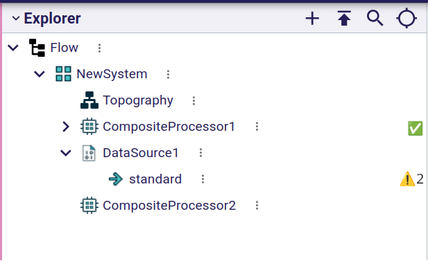

:author: pcdavid
:date: 2026-12-23
:status: proposed
:consulted: Stéphane Begaudeau, William Piers
:informed: Stéphane Begaudeau, William Piers, Mélanie Bats
:deciders: Stéphane Begaudeau
:issue: https://github.com/eclipse-sirius/sirius-web/issues/7200

= (S) Add support for configurable Explorer tree item decorators

== Problem

https://github.com/eclipse-sirius/sirius-web/issues/6355[Issue #6355] (see also ADR-227) introduced support for decorators on diagram nodes, but not on tree items.
This is a limitation for users who want to add visual cues to tree items in the Sirius Web application.

== Key Result

An application based on Sirius Web should be able to define custom decorators for tree items in the Explorer, similar to how decorators are defined for nodes.

These decorators will be displayed on the right side of the tree item (right-aligned).
Each decorator includes a (mandatory) icon and an optional label.
Decorator are not interactive, and are only meant to provide visual cues to the user.

It should be possible to contribute multiple decorators to a single tree item, in which case they will be displayed side by side, with a small gap between them.
The order of decorators should be stable (but not necessarily configurable, at least for the time being).

Tree item decorators will be defined through a Java API only for the moment (not exposed in the DSL).

=== Acceptance Criteria

It should be possible to configure decorators to the existing _Explorer_ description without replacing it with a custom one.
In other words, an application based on Sirius Web which reuses the default _Explorer_ description should be able to extend it with additional decorators without having to replace/modify the original description.

Rendering a tree with decorators should not have a significant impact on performance, even for large trees, especially when the decorators are not visible (e.g. when the tree is collapsed) or when the decorators are not contributed for a given editing context, tree or tree item.

== Solution

The solution will follow extend the existing configurations mechanisms for the _Explorer_ (the various `IExplorer*Service` APIs).

The definition of a TreeItem will be extended to include a list of decorators, each of which will have an icon and an optional label.

The frontend will fetch this new information and simply render the decorators (icon and text) on the right side of the tree item.

=== Breadboarding

An example Explorer with two items, each with one decorator (one with a label, one without), which could represent e.g. a kind of validation status.

=== Cutting backs

- Support for the label, if an approach with only icons is simpler/quicker to implement.
This could be added later if needed, or the backend could generate `data:` SVG images with the label text inside if we want to avoid adding a label to the API for now.

== Rabbit holes

None.

== No-gos

- Support all tree views (for now, we only want to support the Explorer).
- Make this configurable in the DSL (for now, we only want to support Java API contributions).
- Make decorators richer (custom React components) or interactive (for now, we only want to support simple visual cues).
- Handle the case where there are too many decorators to fit in the available space (for now, we will assume that the number of decorators is small enough to fit in the available space).